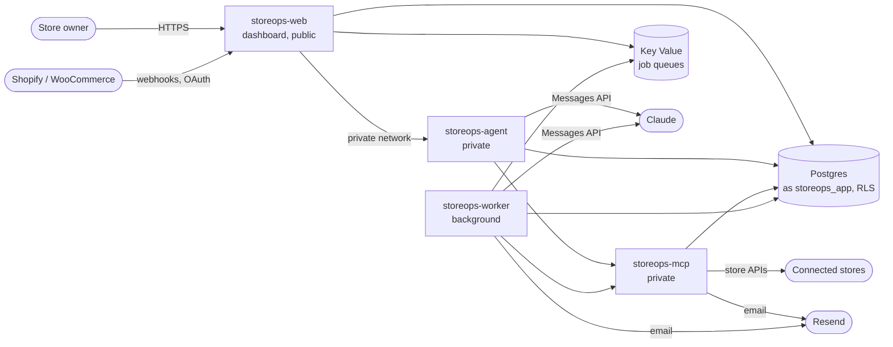

# Deploying

The platform runs as four Node services plus Postgres and Redis. [`render.yaml`](../render.yaml) describes all of it as a Render Blueprint: the dashboard is the only public service, the agent API and MCP server are private services, and Redis accepts no outside connections.

## 1. Before you start

- A Render account with the repository connected (GitHub or GitLab).
- A Claude API key, with a **monthly spend limit** set on the Claude account. Per-store budgets stop runs inside the app; the account limit is the backstop.
- A Resend account with your sending domain verified, for approval links, digests and alerts. Without `RESEND_API_KEY` emails are only printed to the service logs.
- Optional: a Shopify app (see [shopify-setup.md](shopify-setup.md)). It needs the dashboard's public HTTPS address.

## 2. Create the Blueprint

In Render, choose **New → Blueprint**, pick the repository and keep `render.yaml`. Render creates the database, Redis and the four services in Singapore (change `region` in the file first if your owners are elsewhere; it cannot be changed later). The file sets no instance sizes, so Render's defaults apply; choose larger ones in the dashboard if you need them. The pre-deploy step that runs migrations needs a paid instance type for the dashboard.

Render generates these once, in the `storeops-shared` group: `CREDENTIALS_ENCRYPTION_KEY`, `SESSION_SECRET`, `APPROVAL_LINK_SECRET`, `AGENT_INTERNAL_TOKEN`, `MCP_INTERNAL_TOKEN`.

> **Back up `CREDENTIALS_ENCRYPTION_KEY`.** Every store's credentials are encrypted with it. If it is lost or changed, every owner has to reconnect their store.

Render then asks for the values it cannot generate. Some are asked once per service that uses them; enter the same value each time.

| Variable | Services | Value |
| --- | --- | --- |
| `APP_DATABASE_URL` | all four | `postgresql://storeops_app:<password>@<host>/storeops`: the database's **internal** host, and a new password of at least 16 characters (URL-encode symbols). The pre-deploy step creates the role with it. |
| `APP_URL` | web, MCP, worker | The dashboard's public address, e.g. `https://storeops-web.onrender.com` or your own domain. Approval links, emails and Shopify redirects use it. |
| `ANTHROPIC_API_KEY` | agent, worker | Your Claude API key. |
| `RESEND_API_KEY` | MCP, worker | Your Resend key. |
| `EMAIL_FROM` | MCP, worker | A sender on your verified domain, e.g. `Store Ops Agent <agent@yourdomain.com>`. |
| `SHOPIFY_CLIENT_ID`, `SHOPIFY_CLIENT_SECRET` | web, MCP, worker | From your Shopify app; leave empty to offer Shopify later. |

`DATABASE_URL` (the owner connection, used only by the dashboard's pre-deploy step), `AGENT_URL`, `MCP_URL` and `REDIS_URL` are wired between the services by the Blueprint.

## 3. First deploy

On each dashboard deploy, the pre-deploy step runs as the database owner:

1. creates the `storeops_app` role, or updates its password, from `APP_DATABASE_URL` (`packages/db/scripts/setup-app-role.ts`);
2. applies the migrations, which set up Row-Level Security and grant `storeops_app` only what the app needs.

The services connect as `storeops_app`, never as the owner, so RLS applies to every query. To prepare another Postgres host the same way, set `DATABASE_URL` and `APP_DATABASE_URL` and run `pnpm db:setup`.

When the deploy is live:

- `https://<APP_URL>/api/health` answers `{"ok":true}` (the dashboard can reach its database).
- The worker's log shows `Worker running 5 queues`.
- Sign up, connect a store, and the welcome page shows the first digest within a couple of minutes. If it waits more than a minute with nothing happening, check the worker's log.

## 4. After it is live

- **Shopify:** in your app's settings, set the App URL to `<APP_URL>/stores`, the redirect URL to `<APP_URL>/api/shopify/callback` and the compliance webhooks to `<APP_URL>/api/webhooks/shopify` ([shopify-setup.md](shopify-setup.md)).
- **WooCommerce** webhooks go to `<APP_URL>/api/webhooks/woocommerce/<store id>`, set up automatically when a store connects.
- **Custom connectors** read the spec from `<APP_URL>/connector/openapi.json`.
- **Costs:** every run's cost is on the store's Runs page; the default monthly budget per store is `DEFAULT_MONTHLY_BUDGET_INR` (₹500).

## Other hosts

Any host that runs long-lived Node processes works; each service is started the same way as in `render.yaml` (`npx tsx src/index.ts` in its folder, `npx next start` for the dashboard) after `pnpm install --frozen-lockfile --prod=false`. What matters:

- The agent API and MCP server must not be public. If the dashboard runs on a different network (for example Vercel), the agent API has to be reachable over HTTPS; its bearer token protects it, but keep the MCP server private either way.
- The dashboard and the worker must share one Redis; the dashboard queues "Run now" and first-digest jobs there.
- The chat streams for up to about a minute; a serverless host must allow responses that long (the chat route sets `maxDuration = 120`).
